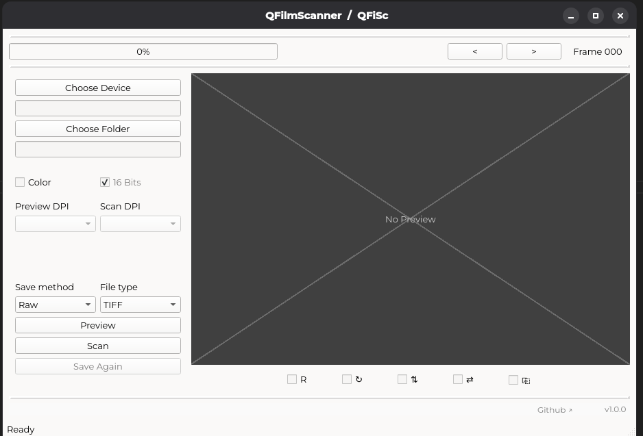
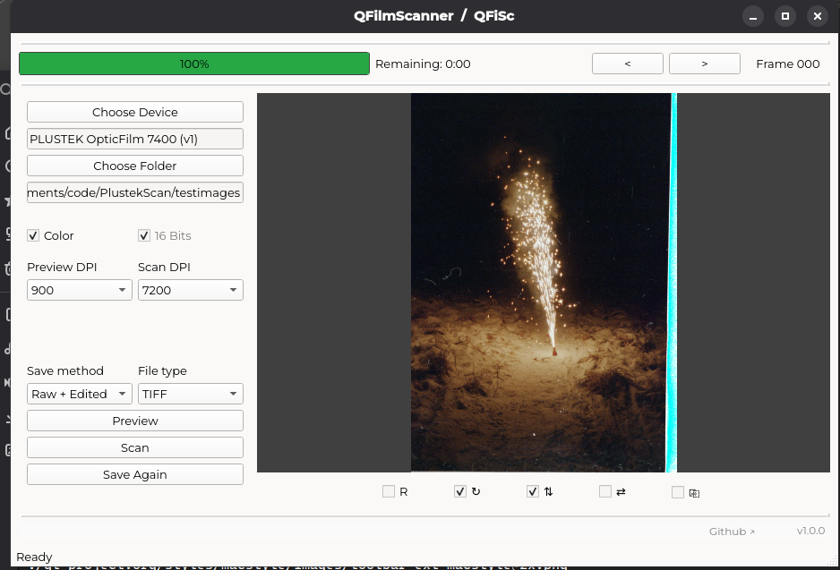

# QFilmScanner
[](https://kernel.org)
[](https://www.qt.io/)
[](http://www.sane-project.org/)
[](https://cmake.org/)
[](https://www.gnu.org/licenses/gpl-3.0)

QFiSc - QT Film Scanner supporting **Plustek** and possibly other **SANE-supported flatbed devices**, on Linux!

## Screenshots

**Default view / Scan done:**  

<div style="display: flex; gap: 20px; align-items: flex-start;">
    
    
</div>
    
---

## Installation via building
 
Building dependencies are:  
- **QT 5.15 and up to 6.10**  
- **CMake 3.16+**
- **C++17 compiler**
- **QT Image formats**

Minimum dependencies are for arch-based distro   
```sudo pacman -S qt6-base qt6-imageformats sane cmake pkgconf base-devel```

For debian , QT6
```sudo apt install build-essential cmake pkg-config qt6-base-dev qt6-image-formats-plugins libsane-dev```

Build with the CMake  
```rm -rf build && mkdir build && cd build```  
```cmake .. && cmake --build .```  

## Usage 

Simply run as executable  

**Preview** does lowest found resolution scan, and does not save by default.  
Previewing does not require choosing a folder.

**Scan** does highest found resolution scan, and saves immediately after scan.

**Saving** overrides similarly named frame without prompt.

**Image edit** buttons do small convenience for later editing. Recommended is to use darktable for final colour correction.
- **R Reversal film**. Enabling disabled colour negation.
- **↻ Flip**. Enabling flips image to vertical.
- **⇄ Mirror** horizontally.
- **⇅ Mirror** vertically.
- **⎘ No depth scaling**. Removes auto-level scaling.

**Shortcuts** are used to quickly change frames when scanning.   
Arrow keys to right move frame counter up, and left move back.  
Arrow UP does a previw scan.
Arrow DOWN does a full scan.
## Features

- Scan previews and final frames  
- Frame-by-frame scanning with automatic numbering  
- Support for **color / black & white**, **16-bit depth**, and basic image transforms (negate, rotate90, mirror horizontally, mirror vertically, auto-level 0.05/99.5%)  
- Save scans in multiple formats (`JPEG`, `PNG`, `TIFF`, `WEBP`, `BMP`) and save methods (`Raw`, `Edited`, `Raw + Edited`)  
- Embedded UI font for consistent look (Montserrat)  
- Status bar

## Tested devices

Tested devices list can be found from [here](SUPPORTED.md).   
The build started for Plustek OpticFilm 7400, but should support all Plustek SANE-supported devices, found [here](http://www.sane-project.org/sane-mfgs.html#Z-PLUSTEK).  

## Coming features for release 1.0.0

 - Arch / Debian packages
 - AppImage building
 - ~~Device tested runtimes~~ Completed as of 0.2.1!
 - ~~Device-specific configs~~ Completed as of 0.2.0!
    - Additionally, configs for film placement for larger devices, e.g. 35mm for 120 scanner
 - Dark mode support dynamically from OS in development
 - 8-bit depth calculations for image transformations
 - ~~QT version dependant building for QT5 / QT6 supports.~~ Completed as of 0.2.3

- - -
Version 0.2.3 - [Pride versioning](https://pridever.org/)
- - -
Made with QT6. Made with SANE-backend. Made with love.